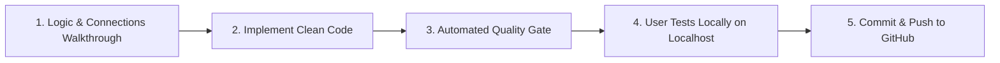

# AHL HR Command Center — 8-Feature FMS Rollout Plan

> **Date**: October 2026  
> **Methodology**: 1 Feature at a Time ➔ Explain Logic & Data Connections ➔ Implement New Modern Code ➔ Automated Test ➔ User Local Verification ➔ Commit & Deploy  
> **Source Reference**: `HR system FMS` (`apps-script/hr-system-fms/`)  
> **Target Codebase**: `Next UI`  

---

## 1. The Strict 5-Step Lifecycle Per Feature

Every single feature will strictly follow this cycle before moving to the next:

1. **Step 1: Logic & Flow Explanation**: Explain how HR uses it, what data fields are stored, and how it connects to our existing features.
2. **Step 2: Clean Implementation**: Write 100% brand-new, modern TypeScript/React 19 code (taking only business logic inspiration from `HR system FMS`).
3. **Step 3: Automated Quality Gate**: Run `npm test` (all tests passing), `npx tsc --noEmit` (0 errors), and `npm run build`.
4. **Step 4: User Local Verification**: You run `npm run dev` and test the UI, buttons, and workflows in your browser.
5. **Step 5: Commit & Push**: Only when you approve, we commit and deploy to GitHub.

---

## 2. The 8 Features & Logical Rollout Order

| Order | Feature Name | Target Location in Next UI | Status | Primary Old Feature Connection |
| :---: | :--- | :--- | :---: | :--- |
| **#1** | **Job Requisitions** | `/recruitment` ➔ Tab "Requisitions" | ✅ **DONE** | Connects to Department list (`/meta/departments`) & anchors all hiring |
| **#2** | **Candidate Applications & Intake** | `/recruitment` ➔ "Add Candidate" Modal | ✅ **DONE** | Links each applicant to an active Requisition & pre-populates FMS |
| **#3** | **Candidate FMS Pipeline** | `/recruitment` ➔ Tab "Candidate FMS" | ✅ **DONE** | Links to HireOS tests + 1-Click "Onboard" into Employee Directory |
| **#4** | **Today's Interviews & Agenda** | `/recruitment` ➔ Tab "Today's Interviews" | ✅ **DONE** | Links to Candidate FMS + instant WhatsApp/Call to candidates |
| **#5** | **Holiday Calendar Sync** | `/calendar` | ⏳ **NEXT UP** | Syncs festive/national holidays for AHL & ALC alongside Salon Meetings |
| **#6** | **Leaves & Approval Workflow** | `/leaves` (and synced to `/calendar`) | ⏳ Queued | Links to Master Employee IDs + reflects employee out-of-office on Calendar |
| **#7** | **Problem Tracker FMS** | `/problems` | ⏳ Queued | Internal operational issue resolution with 4 stages & SLA delays |
| **#8** | **Staff Training FMS** | `/training` | ⏳ Queued | Staff salon skills & onboarding training with 5 stages & attendance |

> 📘 **Handoff Playbook for Next Teammate & Agent**: [`Next UI/docs/TEAM_AGENT_FMS_HANDOFF.md`](file:///c:/Users/admin/Desktop/HR_Dashboard/Next%20UI/docs/TEAM_AGENT_FMS_HANDOFF.md)

---

## 3. Deep Logic & Data Breakdown for Each Feature

---

### Feature 1: Job Requisitions (`/recruitment` ➔ Requisitions Tab)
- **Why it is 1st**: Every candidate must apply for an open job. Without Requisitions, candidate pipelines lack context.
- **How HR will use it**:
  1. HR or Department Head needs to hire (e.g. "Senior Hair Stylist" for Bandra salon, 2 openings, budget 40-50k).
  2. HR opens `/recruitment` ➔ clicks "Create Requisition".
  3. Fills job title, department, brand (`AHL` / `ALC`), experience range, openings count, hiring manager, target start date, and priority.
  4. The system assigns a sequential ID: `REQ-2026-001`.
  5. The card shows total applicants linked to this role, target vs. filled count, and days open.
- **Data Connections**:
  - **Connected to Existing**: Uses our existing `Departments` list (`src/types/index.ts`).
  - **Connects to Future**: Candidate Applications and Candidate FMS select from these active requisitions.
- **Storage**: Local standalone JSON store (`fms-extracted-data.json` / `fms-store.ts`), with 18 real preloaded requisitions ready.

---

### Feature 2: Candidate Applications & Intake (`/recruitment` ➔ Add Candidate Modal)
- **Why it is 2nd**: Captures inbound applicant resumes (from LinkedIn, walk-ins, referrals) before they enter the FMS pipeline.
- **How HR will use it**:
  1. A resume arrives. HR clicks "+ New Application".
  2. Selects the Job Requisition (from Feature 1), enters Candidate Name, Mobile, Email, Experience, Current Location, and Source Channel.
  3. HR can paste resume text or notes.
  4. System assigns `CAND-0042` and places them in Stage 1: "Application Received".
- **Data Connections**:
  - Connects to Requisition ID.
  - Formats phone cleanly using our tested `normalizeFmsPhone()` for instant WhatsApp.

---

### Feature 3: Candidate FMS Pipeline (`/recruitment` ➔ Tab "Candidate FMS")
- **Why it is 3rd**: The core heart of the FMS discussed in the audio transcript.
- **How HR will use it**:
  1. HR views candidates across the 6 pipeline stages in Kanban columns or Table view:
     - `Stage 1: Application Received (ar)`
     - `Stage 2: Pre-Screening (ps)`
     - `Stage 3: Confirmation Call (cc)`
     - `Stage 4: Joining / Offer (jo)`
     - `Stage 5: Documentation & KYC (doc)` (DOB, Gender, Aadhaar, PAN, Bank account, IFSC)
     - `Stage 6: Onboarding (ob)`
  2. Every candidate card displays an **SLA Delay Badge**:
     $$\text{Delay} = \text{Actual Date} - \text{Planned Date}$$
     If overdue, it prominently shows `+N Days Delay` in red so managers never lose track of a candidate.
  3. HR clicks on a candidate to open their **Checklist Drawer**:
     - Can tick off mandatory checklist items (e.g., "Salary expectations discussed", "Aadhaar verified").
     - Can click "Advance to Next Stage" with target date picker.
  4. **The Ultimate Connection to Old Features**: When the candidate completes Stage 6, HR clicks **"Onboard Candidate"** ➔ This automatically opens our existing **5-Step Onboarding Wizard** (`/add-employee`) with candidate details pre-filled, generates their PDF employment contract, and stores them in the Master Employee Directory!

---

### Feature 4: Today's Interviews & Agenda Widget (`/recruitment`)
- **How HR will use it**:
  1. At 9:00 AM, HR opens Recruitment and sees a dedicated top widget: "Today's Interviews (3 Scheduled)".
  2. Shows candidate name, scheduled time, interviewer, and position.
  3. 1-click **WhatsApp button** sends the candidate a meeting reminder.
  4. 1-click **HireOS button** links directly to their AI assessment test result and DISC psychometrics.
- **Data Connections**:
  - Connects Candidate FMS with existing HireOS assessment scores and DISC personality profiles.

---

### Feature 5: Holiday Calendar Sync (`/calendar`)
- **How HR will use it**:
  1. When HR or salon managers open `/calendar`, they already see the First-Wednesday salon meetings, employee birthdays, and review milestones.
  2. Now they will also see all official **Public & Festive Holidays** (Diwali, Holi, Independence Day, Christmas, Republic Day).
  3. Filterable by entity: `American Hairline`, `Alchemane`, or `Both`.
- **Data Connections**:
  - Directly merges into `Next UI`'s interactive full-month calendar (`src/app/(app)/calendar/page.tsx`).

---

### Feature 6: Leaves & Approval Workflow (`/leaves` & `/calendar`)
- **How HR will use it**:
  1. Leave requests table: shows Employee ID, Employee Name, Leave Type (Sick, Casual, Paid), From Date, To Date, Reason, and Status (`Pending`, `Approved`, `Rejected`).
  2. Manager or HR can click "Approve" or "Reject".
  3. Approved leaves automatically display on `/calendar` as "Out of Office" badges so salon managers know who is on duty.
- **Data Connections**:
  - Connects to existing Master Employees in `src/types/index.ts` (`employeeKey`, `empId`).
  - Syncs approved dates into `/calendar`.

---

### Feature 7: Problem Tracker FMS (`/problems`)
- **How HR will use it**:
  1. Salon or staff grievances, operational blockers, or facility issues are logged.
  2. Follows a 4-stage FMS workflow:
     - `P1: Report Logged`
     - `P2: Issue Analysis` (Root Cause, Category, Severity: High/Med/Low)
     - `P3: Resolution Action Plan`
     - `P4: Closed / Verified`
  3. HR tracks SLA turnaround time: shows which problems are overdue and which owner is responsible.
- **Data Connections**:
  - Connects to Employee Directory (who reported it) and Departments.

---

### Feature 8: Staff Training FMS (`/training`)
- **How HR will use it**:
  1. Tracks training programs (Hair extensions workshop, customer service etiquette, salon hygiene).
  2. 5-stage lifecycle:
     - `Planning` ➔ `Scheduling` ➔ `In Progress` ➔ `Evaluation` ➔ `Completed`.
  3. Logs trainer name, date, participant roster count, feedback score, and completion status.
- **Data Connections**:
  - Connects to Employee Directory for participant rosters.

---

## 4. Starting Point: Feature #1 (Job Requisitions)

We propose taking **Feature 1: Job Requisitions** first because:
1. It is the logical root: Candidates and applications require an open job requisition to link to.
2. It allows establishing the local standalone store pattern with zero risk.
3. It has 18 real records already preloaded in `fms-extracted-data.json`.
4. It is compact, visually clear, and 100% testable immediately.
