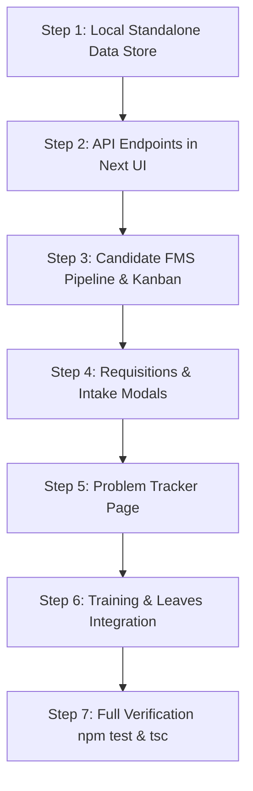

# AHL HR Command Center — FMS Full Feature Migration & Standalone Integration Plan

> **Date**: October 2026  
> **Status**: Ready for User Review (No code changes applied yet)  
> **Target Application**: `Next UI` (`c:\Users\admin\Desktop\HR_Dashboard\Next UI`)  
> **Source System**: `HR system FMS` (`c:\Users\admin\Desktop\HR_Dashboard\HR system FMS`)  
> **Extracted Seed Data**: [`Next UI/src/lib/fms-extracted-data.json`](file:///c:/Users/admin/Desktop/HR_Dashboard/Next%20UI/src/lib/fms-extracted-data.json) (41 Candidates, 18 Requisitions, 5 Problems, 2 Trainings, 7 Leaves, 2 Holidays, 7 Users)

---

## 1. Executive Summary & Transcript Analysis

### What the Voice Transcript Reveals
In the conversation transcript:
- **Speaker A & B Discussion**:
  > *"FMS मध्ये कोणता शीट चा FMS होता?"* (Which sheet's FMS was it?)  
  > *"नवीन कॅन्डिडेट जेव्हा येतो तेव्हा पासून... तेव्हा कॉल केला तेव्हा पासून पुढे त्याचा प्रोसेस..."* (From the moment a new candidate arrives, from when we call them, their entire process forward...)  
  > *"हो तसंच आमचं प्लान होतं, FMS पार्ट बाकी आहे, बाकी सगळे मी ऍड केले, जेवढे आम्ही फीचर्स बनवले आहेत ना, हे सगळे त्या डॅशबोर्ड मध्ये आहेत. फक्त FMS..."* (Yes, that was our plan. All other dashboard features are already in Next UI. **Only the FMS part is remaining...**)  
  > *"रिक्रूटमेंट बद्दलच आहे. विचार राकेश ला या फ्लो चार्ट मध्ये पुढे काय होतं, तुम्ही मला सांगून द्या त्याप्रमाणे मी यामध्ये स्टेप चेंज करून घेतो..."* (It's about recruitment. Ask Rakesh what comes next in this flowchart, tell me and I'll adjust the stage steps...)
- **Core Realization**:
  The existing `Next UI` already has the employee directory, 5-step onboarding wizard, PDF contract generation, first-Wednesday salon meeting engine, and HireOS DISC psychometrics. **The missing puzzle piece is the Candidate Flow Management System (FMS)** — the step-by-step pipeline enforcing SLAs, planned vs. actual dates, delays, and stage checklists.

---

## 2. Direct Answer: Can We Do This Standalone Without Any External Connection?

### **YES, 100% Absolutely.**
We can run `Next UI` **completely self-contained** with zero external API calls or Google Sheets connections:

```
┌────────────────────────────────────────────────────────┐
│                   Next UI (Standalone)                 │
├────────────────────────────────────────────────────────┤
│  Frontend: React 19 + Lucide Icons + Tailwind / CSS    │
│  API Routes: /api/fms/candidates, /requisitions, etc.  │
│  Data Layer: src/lib/fms-store.ts                      │
│        ▲                                               │
│        ▼ (Loads & persists locally)                    │
│  src/lib/fms-extracted-data.json                       │
│  (Real extracted live snapshot: 41 candidates,         │
│   18 requisitions, 5 problems, trainings, etc.)        │
└────────────────────────────────────────────────────────┘
 [ZERO Google Sheets API / ZERO Service Account / ZERO Clasp needed]
```

### How the Standalone Data Engine Works:
1. **Initial Seed**: `src/lib/fms-extracted-data.json` is already created with all the real data from the Google Sheet.
2. **Local In-Memory / File Store (`src/lib/fms-store.ts`)**:
   - Next.js API route handlers (`/api/fms/...`) read and mutate data in this local store.
   - Any edits (updating candidate stage, ticking checklists, logging new problems, adding requisitions) write straight to the local JSON or session storage.
3. **Benefits**:
   - ⚡ **Instant loading**: 0ms network latency to external Google servers.
   - 🔒 **Zero authentication headaches**: Runs completely offline on `localhost:3000`.
   - 🧪 **Deterministic testing**: Every test and UI component works predictably.

---

## 3. Side-by-Side System Comparison

| Feature / Module | In `HR system FMS` (Apps Script) | In `Next UI` Currently | Migration Action |
| :--- | :--- | :--- | :--- |
| **Candidate FMS Pipeline** | 6 stages, SLA delays, checklists, KYC columns | ❌ Missing (Only had HireOS AI link generator) | **Port as new FMS Pipeline Tab in `/recruitment`** |
| **Job Requisitions** | Open jobs, department, headcount target | ❌ Missing | **Add Requisitions Manager in `/recruitment`** |
| **Candidate Applications** | Inbound resume/form intake | ❌ Missing | **Add Intake Form & Candidate Profile Viewer** |
| **Today's Interviews** | Daily interview schedule with Call/WhatsApp | ❌ Missing | **Add Daily Interview Agenda Widget** |
| **Problem Tracker FMS** | 4-stage issue pipeline + Kanban | ❌ Missing | **Add `/problems` FMS Kanban & Table view** |
| **Staff Training FMS** | 5-stage training pipeline + attendance | ❌ Missing | **Add `/training` FMS Module** |
| **Leaves & Approvals** | Leave application, manager approval flow | ❌ Missing | **Add `/leaves` workflow and sync with Calendar** |
| **Holiday Calendar** | Entity-wise holidays (AHL, ALC) | ⚠️ Basic Calendar | **Sync national/festive holidays into `/calendar`** |
| **Employee Master Directory**| Basic HTML table | ✅ Advanced Search, Filters, Drawer, KPIs | **Keep `Next UI`'s superior directory** |
| **Onboarding Wizard** | Form + append row | ✅ 5-Step Wizard + Token link + PDF | **Keep `Next UI` + link FMS "Onboard" button to it** |
| **DISC Psychometrics** | 28 questions + bulk WhatsApp | ✅ HireOS DISC + Audio Review + Reports | **Already native in `Next UI`** |
| **Salon Meeting Engine** | ❌ None | ✅ First-Wednesday 10 AM IST WhatsApp (R3-R0) | **Preserve as core strength in `Next UI`** |

---

## 4. Architectural & UI Design: How It Will Look in `Next UI`

### View 1: Recruitment FMS Hub (`/recruitment` -> Tab "Candidate FMS")
We will add a prominent new tab **"Candidate FMS Pipeline"** alongside the existing HireOS tabs:
`[ 🚀 Candidate FMS ]  [ 📋 Requisitions ]  [ 🤖 AI Tests ]  [ 🎯 ICP ]  [ 👥 Employee DISC ]  [ 🎙️ Audio Review ]`

#### Pipeline Stages & SLA Delays:
```
  [Stage 1: Application] ➜ [Stage 2: Pre-Screening] ➜ [Stage 3: Confirmation Call] ➜ 
  [Stage 4: Interviews]  ➜ [Stage 5: Offer / Joining] ➜ [Stage 6: Onboarding & Doc]
```
Each Candidate Card displays:
- **Candidate Name, Position, Brand** (`AHL` / `ALC`), Phone, Experience.
- **SLA Badge**:
  - 🟢 **On Time**: Completed within planned date.
  - 🟡 **In Progress**: Active, due soon.
  - 🔴 **Delayed (+3 Days)**: Explicit delay count ($\text{Delay} = \text{Actual} - \text{Planned}$).
- **Checklist Progress Bar**: e.g., `3/5 items completed`.
- **Quick Actions**:
  - 📞 Call / 💬 WhatsApp icon (`wa.me/91...`).
  - 📄 Open Resume / Profile Modal.
  - ⏩ "Advance to Next Stage" modal with checklist checkboxes & planned date picker.
  - 🎓 "Promote to Onboarding" (triggers `Next UI`'s employee creation with pre-filled details!).

---

### View 2: Job Requisitions Manager (`/recruitment` -> Tab "Requisitions")
- Displays open job requisitions:
  - Role Title, Department, Openings count, Applicants count, Priority (`High`/`Medium`/`Low`).
  - Budget range, Target start date, Recruiter assigned.
- "Create Requisition" modal: allows HR to spin up new requisitions without touching spreadsheets.

---

### View 3: Problem Tracker FMS (`/problems`)
- Dedicated operational workflow page for salon and HR issues:
- **Kanban & Table Views**:
  - Column 1: `Report Logged`
  - Column 2: `Issue Analysis` (Root Cause, Category)
  - Column 3: `Resolution Action Plan`
  - Column 4: `Closed / Verified`
- SLA tracking: calculates days taken to resolve each grievance.

---

### View 4: Staff Training FMS (`/training`)
- Corporate and salon staff training tracker:
- 5 stages: `Planning` ➜ `Scheduling` ➜ `In Progress` ➜ `Evaluation` ➜ `Completed`.
- Tracks trainer name, participant count, session date, and feedback ratings.

---

### View 5: Leave Management & Holiday Sync (`/leaves` & `/calendar`)
- Leave requests with status (`Pending`, `Approved`, `Rejected`).
- Multi-brand holiday calendar preloaded with Indian festival dates (Diwali, Holi, Independence Day, etc.) merged directly into `Next UI`'s interactive calendar.

---

## 5. Step-by-Step Implementation Roadmap



### Phase 1: Local Data Layer (Zero External Connection)
- Create `src/lib/fms-store.ts`:
  - In-memory / file-backed JSON store seeded by `fms-extracted-data.json`.
  - Methods: `getCandidates()`, `updateCandidateStage()`, `getRequisitions()`, `createRequisition()`, `getProblems()`, `updateProblem()`, `getTrainings()`, `getLeaves()`.
- Verified 100% offline, zero network dependencies.

### Phase 2: Internal Next.js API Routes
- `src/app/api/fms/candidates/route.ts`: List and update candidates.
- `src/app/api/fms/requisitions/route.ts`: List and create requisitions.
- `src/app/api/fms/problems/route.ts`: CRUD for problem tracker.
- `src/app/api/fms/training/route.ts`: CRUD for training sessions.
- `src/app/api/fms/leaves/route.ts`: Leave requests and approvals.

### Phase 3: Candidate FMS UI in `/recruitment`
- Build `CandidateFmsTab.tsx`:
  - Stage filters, Search by candidate or position.
  - Kanban board with stage columns + Table view toggle.
  - Stage checklist drawer: lets HR check off items (Aadhaar verified, bank details saved, offer accepted) and updates delay metrics in real time.
  - "Onboard Candidate" action linking to `Next UI` master onboarding.

### Phase 4: Problem Tracker & Training Pages
- Build `src/app/(app)/problems/page.tsx`:
  - 4-stage problem FMS Kanban.
  - Add Problem modal with category, severity, and root cause notes.
- Build `src/app/(app)/training/page.tsx`:
  - 5-stage training program cards with attendance count.

### Phase 5: Verification & Testing
- Add comprehensive unit tests in `Next UI/tests/` for all store operations and delay computations.
- Validate `npm test` (all 63+ tests pass).
- Validate `npx tsc --noEmit` (0 TypeScript errors).
- Validate `npm run build` production build succeeds.

---

## 6. Questions & Confirmation for You

Before we start applying any code, please confirm:
1. **Recruitment Placement**: Should the Candidate FMS pipeline live as the first primary tab inside `/recruitment` (alongside HireOS AI tests), or would you prefer a separate top-level sidebar item `/candidate-fms`?
2. **Problem Tracker & Training**: Should we create `/problems` and `/training` as new sidebar navigation items in `Next UI`?
3. **Data Mode**: Do you agree with the **100% Standalone Local Store** mode (instant, preloaded with all 41 candidates and 18 requisitions, 0 external connections)?

Once you approve, we can begin Step 1!
