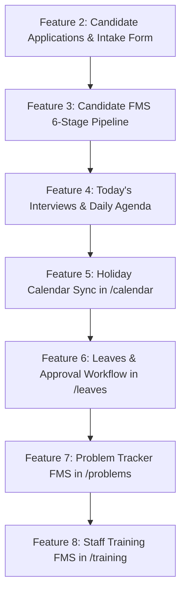

# AHL HR Command Center — Team Agent Handoff & Implementation Playbook

> **Target Audience**: AI Coding Agent (Cursor, Windsurf, Claude Code, Copilot, Antigravity) & Collaborating Engineer.  
> **Repository**: `HR_Dashboard/Next UI`  
> **Node/Framework**: Next.js 16.3 (Turbopack, App Router), React 19, TypeScript (strict), Tailwind CSS.  
> **Status**: Feature 1 (Job Requisitions) & Sidebar Split are **COMPLETED**. Features 2–8 are queued for implementation.  
> **Cleanup Notice**: *Once all features below are implemented, tested, and deployed to production, this file can safely be deleted (`git rm docs/TEAM_AGENT_FMS_HANDOFF.md`).*

---

## 1. High-Level System Architecture & Invariants

### 1.1 Core Mission
The **AHL HR Command Center** manages people operations, onboarding, salon meeting automations, and recruitment for American Hairline (`AHL`) and American Laser Clinic (`ALC`).  
We are porting the legacy flow management modules from Google Apps Script (`apps-script/hr-system-fms/`) into modern, beautiful, responsive Next.js components.

### 1.2 Standalone Local Architecture (Zero External Connections Needed)
- **Do NOT create external Google Sheets or database credentials** for these FMS features during development.
- All live data has been extracted into a local snapshot:
  - Data file: [`src/lib/fms-extracted-data.json`](file:///c:/Users/admin/Desktop/HR_Dashboard/Next%20UI/src/lib/fms-extracted-data.json) (contains 41 candidates, 18 requisitions, 5 problems, trainings, leaves, holidays).
  - Business rules & delay calculations: [`src/lib/fms-rules.ts`](file:///c:/Users/admin/Desktop/HR_Dashboard/Next%20UI/src/lib/fms-rules.ts).
  - TypeScript types: [`src/types/fms.ts`](file:///c:/Users/admin/Desktop/HR_Dashboard/Next%20UI/src/types/fms.ts).
  - Reference legacy code: [`apps-script/hr-system-fms/`](file:///c:/Users/admin/Desktop/HR_Dashboard/Next%20UI/apps-script/hr-system-fms/) (`Code.js`, `Index.html`).
- Stores should follow the in-memory singleton pattern demonstrated in [`src/lib/fms-requisitions-store.ts`](file:///c:/Users/admin/Desktop/HR_Dashboard/Next%20UI/src/lib/fms-requisitions-store.ts).

### 1.3 Strict Rules & Verification Protocol
1. **Never break existing tests**: Run `npm test` before and after every feature (75+ unit/integration tests must pass).
2. **Strict TypeScript**: Run `npx tsc --noEmit` — 0 errors allowed.
3. **Build Verification**: Run `npm run build` — Turbopack compilation must succeed.
4. **Localhost Verification**: Ensure the feature is tested at `http://localhost:3000` before committing to git.
5. **No Placeholder Images/Broken Links**: Always use Lucide icons and clean SVG/tailwind styling.

---

## 2. Current Status & What Has Been Built

### ✅ COMPLETED: Navigation & Sidebar Separation
- **`Recruitment`** (`/recruitment`): Defined in [`src/app/(app)/recruitment/page.tsx`](file:///c:/Users/admin/Desktop/HR_Dashboard/Next%20UI/src/app/(app)/recruitment/page.tsx). Houses Job Requisitions, Candidate Applications, Candidate FMS Pipeline, and Today's Interviews.
- **`AI Tests`** (`/ai-tests`): Defined in [`src/app/(app)/ai-tests/page.tsx`](file:///c:/Users/admin/Desktop/HR_Dashboard/Next%20UI/src/app/(app)/ai-tests/page.tsx). Houses the 5 HireOS tabs:
  1. *Generate Assessment*
  2. *ICPs (Profiles)*
  3. *Candidate Results*
  4. *Employee DISC*
  5. *Audio Review*
- **Sidebar & Header**: Updated in [`src/components/layout/Shell.tsx`](file:///c:/Users/admin/Desktop/HR_Dashboard/Next%20UI/src/components/layout/Shell.tsx) and [`src/app/(app)/layout.tsx`](file:///c:/Users/admin/Desktop/HR_Dashboard/Next%20UI/src/app/(app)/layout.tsx).

### ✅ COMPLETED: Feature 1 — Job Requisitions
- **Store**: [`src/lib/fms-requisitions-store.ts`](file:///c:/Users/admin/Desktop/HR_Dashboard/Next%20UI/src/lib/fms-requisitions-store.ts) (pre-seeded with 18 real requisitions, supports `list`, `getById`, `create`, `update`, `delete`, `getStats`).
- **API**: [`src/app/api/recruitment/requisitions/route.ts`](file:///c:/Users/admin/Desktop/HR_Dashboard/Next%20UI/src/app/api/recruitment/requisitions/route.ts) (`GET`, `POST`, `PATCH`).
- **UI Component**: [`src/components/recruitment/RequisitionsTab.tsx`](file:///c:/Users/admin/Desktop/HR_Dashboard/Next%20UI/src/components/recruitment/RequisitionsTab.tsx) (KPI counters, search, multi-filters, Grid & Table view switcher, "+ New Requisition" modal, View details modal).

---

## 3. Remaining Features Roadmap (Features 2 through 8)

The remaining 7 features should be implemented in this order:



---

### 🟢 Feature 2: Candidate Applications & Inbound Intake Form
- **Goal**: Allow HR to view inbound candidate applications and quickly add new applicants linked to active Job Requisitions.
- **Location**: In `/recruitment`, add a tab or modal: `"Candidate Applications"` / `"Add Candidate"`.
- **Data Connections**:
  - Store: Create [`src/lib/fms-candidates-store.ts`](file:///c:/Users/admin/Desktop/HR_Dashboard/Next%20UI/src/lib/fms-candidates-store.ts) initialized from `seedData.candidates` (41 candidates).
  - API: `src/app/api/recruitment/candidates-fms/route.ts` (`GET`, `POST`).
- **Form Fields**:
  - `name`: Candidate full name (required)
  - `phone`: Mobile number (normalize with `normalizeFmsPhone`)
  - `email`: Email address
  - `requisitionId`: Dropdown selector populated from active requisitions
  - `role`: Pre-filled from selected requisition
  - `experience`: Years of experience
  - `source`: Source channel (`LinkedIn`, `Walk-in`, `Referral`, `Indeed`, `WhatsApp`)
  - `resumeUrl` or `resumeText`: Text or link
  - `currentLocation` & `preferredLocation` (e.g. Bandra salon, Andheri salon)
- **On Submit**: Automatically places candidate into Stage 1 (`ar`: Application Received) with Planned Date = today, and auto-increments candidate ID (`CAN-2026-042`).

---

### 🟢 Feature 3: Candidate FMS Pipeline (6 Stages)
- **Goal**: Full Kanban board and data table tracking candidate progression through 6 operational stages with SLA delay calculations.
- **Location**: In `/recruitment`, as the central tab: `"Pipeline FMS"`.
- **The 6 Stages** (Defined in [`src/types/fms.ts`](file:///c:/Users/admin/Desktop/HR_Dashboard/Next%20UI/src/types/fms.ts)):
  1. `ar` (Application Received) — Target: 1 day (0.14 wks)
  2. `ps` (Pre-Screening) — Target: 3 days (0.43 wks)
  3. `cc` (Confirmation Call / Interview Scheduled) — Target: 2 days (0.29 wks)
  4. `jo` (Job Offer & Acceptance) — Target: 3 days (0.43 wks)
  5. `doc` (Document Collection & KYC) — Target: 7 days (1.00 wks)
  6. `ob` (Onboarding & Joined) — Target: 7 days (1.00 wks)
- **Key Features to Build**:
  - **Kanban Column Board**: Columns for each of the 6 stages with candidate cards showing Name, Role, SLA Delay Badge, and Checklist completion count.
  - **SLA Delay Badge**:
    - Delay calculated via `calculateFmsDelay(stagePlannedDate, stageActualDate)`.
    - `delay > 0` ➔ Red badge (`+N days late`).
    - `delay === 0` ➔ Amber badge (`Due today`).
    - `delay < 0` ➔ Green badge (`On track / Early`).
  - **Candidate Drawer / Action Modal**:
    - Stage checklist toggles (e.g. "Verified contact", "Salary discussed", "Aadhaar collected").
    - Advance to next stage button (auto-computes next stage planned date via `getNextStagePlannedDate`).
    - Mark as Dropped / Rejected with reason.
  - **1-Click Onboard Bridge**:
    - When candidate reaches Stage 6 (`ob` - Onboarding), provide a button **"Promote to Onboarding"** that navigates to `/add-employee` with candidate name, phone, email, and role prefilled in query parameters!

---

### 🟢 Feature 4: Today's Interviews & Daily Agenda
- **Goal**: Give the recruiter an instant cockpit view of all interviews scheduled for "Today".
- **Location**: Top widget or tab in `/recruitment`.
- **Functionality**:
  - Filters candidates in Stage `cc` (Confirmation Call / Interview Scheduled) where `interviewDate === today`.
  - Shows interview time, candidate name, position, interviewer, salon location, and interview mode (On-site / Video).
  - Action buttons:
    - 🟢 **WhatsApp Candidate**: Opens `https://wa.me/91<phone>?text=...` with meeting reminder.
    - 📞 **Call**: `tel:<phone>`.
    - 📝 **Log Feedback**: Opens modal to mark `Passed` (moves to `jo` Offer stage) or `Rejected`.

---

### 🟢 Feature 5: Holiday Calendar Sync
- **Goal**: Display entity-specific public/festive holidays on the existing HR Calendar.
- **Location**: Modify [`src/components/calendar/CalendarView.tsx`](file:///c:/Users/admin/Desktop/HR_Dashboard/Next%20UI/src/components/calendar/CalendarView.tsx) and `/calendar`.
- **Data Source**: `seedData.holidays` (21 holidays for AHL and ALC with `name`, `date`, `day`, `entity`).
- **Functionality**:
  - Renders holiday chips on monthly/weekly calendar grid alongside existing salon review meetings and birthdays.
  - Entity filter: `All Entities`, `AHL (American Hairline)`, `ALC (American Laser Clinic)`.
  - Holiday details popover on click.

---

### 🟢 Feature 6: Leaves & Approval Workflow
- **Goal**: Employee leave requests, balance tracking, manager approval flow, and calendar sync.
- **Location**: New route `src/app/(app)/leaves/page.tsx` + Sidebar item in `Shell.tsx` under People Operations.
- **Data Source**: `seedData.leaves` (25 leave records with `employeeName`, `leaveType`, `startDate`, `endDate`, `status`, `reason`).
- **Functionality**:
  - KPI Cards: `Pending Approvals`, `Approved This Month`, `On Leave Today`.
  - Status Badges: `Pending` (amber), `Approved` (emerald), `Rejected` (rose).
  - Leave Application Modal: Select employee, leave type (`Sick`, `Casual`, `Paid`, `Unpaid`), date range, notes.
  - Manager Action: 1-click `Approve` or `Reject` with remarks.
  - Calendar Sync: Approved leaves reflect on the `/calendar` as out-of-office blocks.

---

### 🟢 Feature 7: Problem Tracker FMS
- **Goal**: Operational issue resolution workflow for salon operations and management.
- **Location**: New route `src/app/(app)/problems/page.tsx` + Sidebar item in `Shell.tsx`.
- **4 Stages** (Defined in [`src/types/fms.ts`](file:///c:/Users/admin/Desktop/HR_Dashboard/Next%20UI/src/types/fms.ts)):
  1. `rep` (Problem Reported) — 1 day
  2. `inv` (Investigation & Root Cause Analysis) — 2 days
  3. `act` (Action Plan & Correction) — 4 days
  4. `res` (Resolved & Verified) — 2 days
- **Functionality**:
  - Kanban & Table view toggle.
  - SLA delay tracking for problem resolution.
  - Filter by Department (`Operations`, `Salon Management`, `Inventory`, `Customer Service`), Priority (`Critical`, `High`, `Medium`, `Low`).
  - "+ Report Problem" modal.

---

### 🟢 Feature 8: Staff Training FMS
- **Goal**: Tracking salon skill upgrades, onboarding training, and certifications.
- **Location**: New route `src/app/(app)/training/page.tsx` + Sidebar item in `Shell.tsx`.
- **5 Stages** (Defined in [`src/types/fms.ts`](file:///c:/Users/admin/Desktop/HR_Dashboard/Next%20UI/src/types/fms.ts)):
  1. `req` (Training Requested)
  2. `sch` (Scheduled)
  3. `inp` (In Progress)
  4. `evl` (Practical Evaluation & Test)
  5. `com` (Completed & Certified)
- **Functionality**:
  - Trainee roster with attendance checks (Day 1, Day 2, Final Assessment).
  - Scoring & Certificate pass/fail indicator.

---

## 4. UI/UX Design System Standards

Match the existing clean, premium styling found throughout the application:
- **Card Styling**: `bg-surface rounded-xl border border-borderline shadow-card p-5`
- **Headings**: `text-navy font-bold text-base` (titles), `text-muted text-xs` (subtitles)
- **Primary Action Buttons**: `bg-primary text-white hover:bg-primary/95 text-xs font-semibold px-4 py-2 rounded-lg transition-all shadow-sm flex items-center gap-2`
- **Secondary Buttons**: `bg-canvas border border-borderline text-navy hover:bg-slate-100 text-xs font-medium px-3 py-1.5 rounded-lg transition-colors`
- **Status Badges**:
  - Completed / Active / Pass: `bg-emerald-50 text-emerald-700 border border-emerald-200`
  - Pending / Warning / In Progress: `bg-amber-50 text-amber-700 border border-amber-200`
  - Delayed / Urgent / Dropped: `bg-rose-50 text-rose-700 border border-rose-200`
  - Info / Scheduled: `bg-indigo-50 text-primary border border-indigo-200`
- **Icons**: Always import from `lucide-react`.

---

## 5. Verification Commands

Before concluding any feature, execute these commands in `Next UI`:
```powershell
# 1. Strict TypeScript check (must exit 0)
npx tsc --noEmit

# 2. Automated test suite (all 75+ tests must pass)
npm test

# 3. Production build verification (must compile cleanly)
npm run build
```

---

## 6. Git Hygiene
- Commit messages should be structured: `feat(fms): implement <feature-name> with tests and local store`
- Never commit `.env` or sensitive credentials.
- After all features are live and verified, remove this file:
```bash
git rm docs/TEAM_AGENT_FMS_HANDOFF.md
git commit -m "chore: cleanup fms implementation handoff playbook after feature rollout"
```
